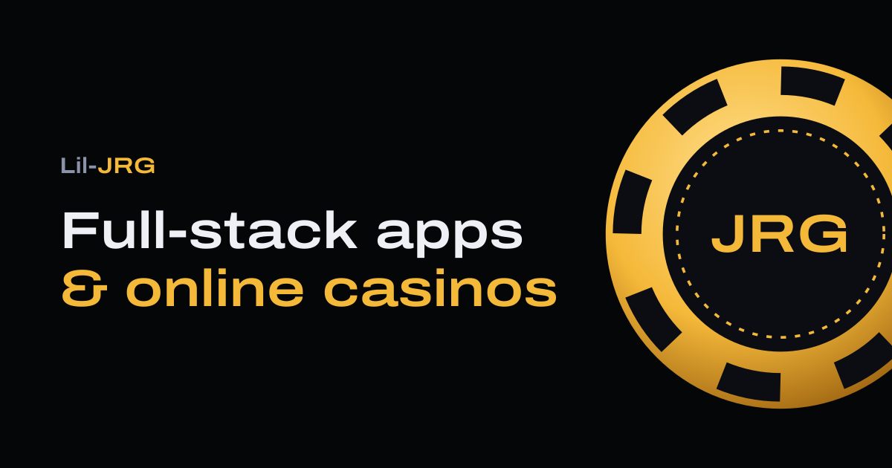

  

  
  
  

Full-stack developer. I build web apps end to end, from the interface to the API and the database: CRMs, ERPs, booking sites, dashboards and realtime features.

Lately most of my work is online casinos. Right now I'm building [TreasureGG](https://treasure.gg) front to back: its original games (Case Battles, Case Opening, Mines, Blackjack and Keno), the crypto cashier, live chat and admin panel. You can play a Mines round and use the live chat on [my portfolio](https://lil-jrg.dev).

### Stack

  

### Activity

Most of my work lives in private client repos, so the graph counts those contributions too.

  

<picture>
  <source media="(prefers-color-scheme: dark)" srcset="https://raw.githubusercontent.com/LIL-JRG/LIL-JRG/output/snake-dark.svg">
  
</picture>

Open to freelance work on web apps and casino platforms. Reach me through the <a href="https://lil-jrg.dev/#contact">contact form</a>.
